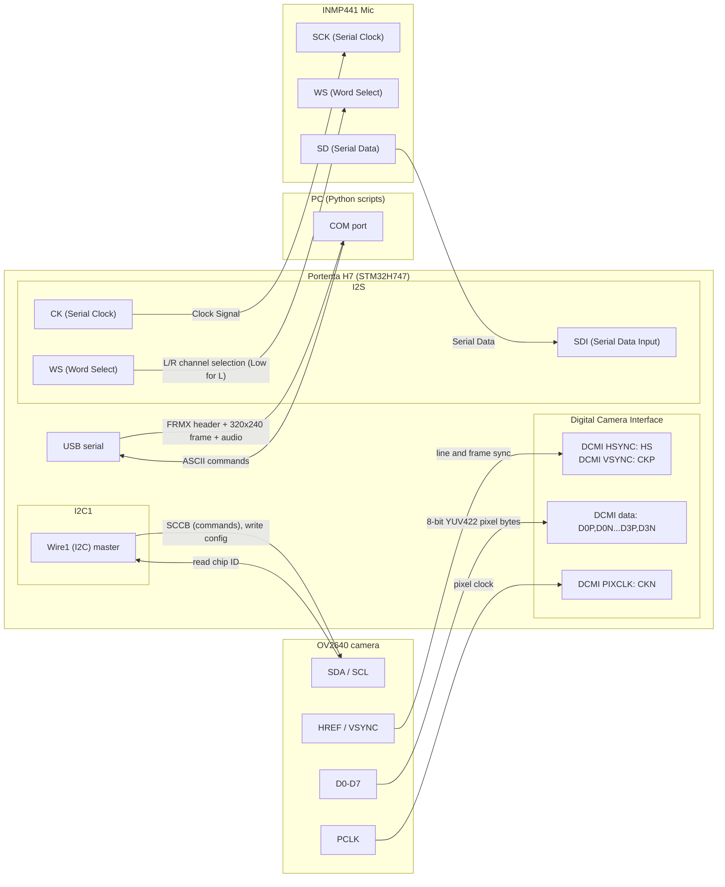

## Pinout Configuration

### 1. INMP441 Microphone Wiring (I2S Cluster)

| INMP441 Pin | Breakout I2S Pin | STM32H7 Pin | Description & Notes                       |
| :---------- | :--------------- | :---------- | :---------------------------------------- |
| VDD         | 3V3              | N/A         | 3.3 V                                     |
| GND         | GND              | N/A         | GND                                       |
| L/R         | GND              | N/A         | GND or 3.3V (L or R channel respectively) |
| MS (WS)     | WS               | PB_9        | I2S Word Select                           |
| SCK         | CK               | PD_3        | I2S Continuous Serial Clock               |
| SD          | SDI              | PI_2        | I2S Serial Data In                        |

### 2. OV2640 18-Pin Camera Wiring (CAMERA & I2C Clusters)

| OV2640 Pin | Breakout Cluster | Breakout Pin | STM32H7 Pin | Function & Notes                           |
| :--------- | :--------------- | :----------- | :---------- | :----------------------------------------- |
| 3.3        | I2C3 Cluster     | 3V3          | N/A         | 3.3 V                                      |
| GND        | CAMERA (Pin 1)   | GND          | N/A         | GND                                        |
| SDA        | I2C3 Cluster     | SDA          | PH_8        | I2C3 Data (Camera register configuration)  |
| SCL        | I2C3 Cluster     | SCL          | PH_7        | I2C3 Clock (Camera register configuration) |
| HREF       | CAMERA (Pin 2)   | HS           | PA_4        | DCMI Horizontal Sync                       |
| PCLK       | CAMERA (Pin 3)   | CKN          | PA_6        | DCMI Pixel Clock                           |
| VSNC       | CAMERA (Pin 4)   | CKP          | PI_5        | DCMI Vertical Sync                         |
| D0         | CAMERA (Pin 11)  | D0N          | PH_9        | DCMI Data 0                                |
| D1         | CAMERA (Pin 12)  | D0P          | PH_10       | DCMI Data 1                                |
| D2         | CAMERA (Pin 9)   | D1N          | PH_11       | DCMI Data 2                                |
| D3         | CAMERA (Pin 10)  | D1P          | PH_12       | DCMI Data 3                                |
| D4         | CAMERA (Pin 7)   | D2N          | PH_14       | DCMI Data 4                                |
| D5         | CAMERA (Pin 8)   | D2P          | PI_4        | DCMI Data 5                                |
| D6         | CAMERA (Pin 5)   | D3N          | PI_6        | DCMI Data 6                                |
| D7         | CAMERA (Pin 6)   | D3P          | PI_7        | DCMI Data 7                                |
| PWDN       | Any GND Header   | GND          | N/A         | GND (Keeps camera awake)                   |
| RST        | Any 3V3 Header   | 3V3          | N/A         | 3V3 (Keeps camera active)                  |
| NC         | Disconnected     | None         | N/A         | Not Connected                              |

## Edge Impulse

### 1. Dataset Sources

| Dataset Source    | Target Class | Scale / Format            |
| :---------------- | :----------- | :------------------------ |
| Axon Footstep     | footstep     | 50 hours annotated audio  |
| ESC-50            | Both classes | 2,000 5-second clips      |
| DCASE (Domestic)  | non-footstep | Domestic background audio |
| DREGON            | non-footstep | Mechanical ego-noise      |
| FSD50K & AudioSet | Both classes | 51k to 2M+ audio clips    |

### 2. Edge Impulse Configuration Parameters

| Pipeline Stage     | Parameter          | Value            |
| :----------------- | :----------------- | :--------------- |
| Time-Series Window | Window Size        | 1000 ms          |
| Time-Series Window | Window Increase    | 500 ms           |
| Time-Series Window | Sampling Frequency | 16000 Hz         |
| Audio MFE Block    | Frame Length       | 0.02 s (20 ms)   |
| Audio MFE Block    | Frame Stride       | 0.01 s (10 ms)   |
| Audio MFE Block    | Filter Number      | 32               |
| Audio MFE Block    | FFT Length         | 256 or 512       |
| Neural Network     | Architecture       | 1D CNN           |
| Neural Network     | Training Cycles    | 50 to 100 epochs |
| Neural Network     | Learning Rate      | 0.005            |
| Neural Network     | Batch Size         | 32 or 64         |
| Deployment         | Model Optimization | int8 Quantized   |
## Project Structure
